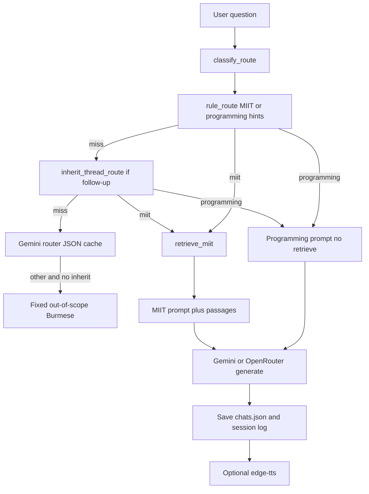

# Working flow

How this tutor answers a question, from setup through Gradio, routing, MIIT notes, Gemini, saved chats, and speech. Laptop install steps live in [LAPTOP_SETUP.md](LAPTOP_SETUP.md).

The app is a **hybrid Burmese tutor**. Programming questions go to a cloud chat model. MIIT faculty, campus, and curriculum questions retrieve local notes, then the same model answers **only from those passages**. Anything else gets a fixed out-of-scope refusal.

There is no local fine-tuned model. Chat is Gemini (`gemini-2.0-flash` by default) or OpenRouter.

## Surfaces

All three call `HybridEngine.answer()` in [`tutor/hybrid.py`](../tutor/hybrid.py):

| Surface | Command | History / chats | Extra |
|---------|---------|-----------------|-------|
| Gradio | `make app` | Yes. Sidebar + `results/chats.json` | TTS, scores, theme |
| HTTP API | `make serve-api` | No | `POST /v1/chat`, optional `TUTOR_API_KEY` |
| CLI | `make chat` | No | Optional pasted code |

Only Gradio keeps a thread. Follow-ups such as “အဲဒါအပို ရှိသေးလဲ။” stay on topic there; API and CLI treat every call as a new question.

---

## 1. Setup

1. `uv sync --extra app`
2. `cp .env.example .env` and set `GEMINI_API_KEY` (Google AI Studio). Where Google APIs are blocked, use a VPN.
3. `make miit-index` — embed `data/miit/*.jsonl` (needs network + the same key). Writes `data/miit/index.json` (gitignored).
4. `make preflight` — then `make app` → http://127.0.0.1:7860

Optional keys in `.env`:

| Variable | Used for |
|----------|----------|
| `GEMINI_API_KEY` | Chat answers and embeddings |
| `GEMINI_API_KEY_FALLBACK` | Chat only, if the primary key hits 429 |
| `GEMINI_TTS_NAMES_API_KEY` | Ask-time route classifier + TTS person-name JSON. Never used for the chat answer |
| `HYBRID_CHAT_PROVIDER=openrouter` | Chat via OpenRouter instead of Gemini |

After you edit any `data/miit/*.jsonl` file, run `make miit-index` again.

---

## 2. Index build (`make miit-index`)

[`scripts/build_miit_index.py`](../scripts/build_miit_index.py):

1. Load every `*.jsonl` under `data/miit/` (`id`, `text`, `sources[]`).
2. Embed all `text` fields with `GEMINI_EMBED_MODEL` (default `gemini-embedding-001`) via [`tutor/gemini_client.py`](../tutor/gemini_client.py).
3. Write `data/miit/index.json`: `{embed_model, built_at, chunks: [{id, text, sources, embedding}]}`.
4. Clear in-memory index caches.

Notes shipped today:

- `institute.jsonl` — campus, governance, programs
- `bachelor_admission.jsonl` — B.E. (Hons) CSE/ECE admission
- `cse_be_hons.jsonl` — CSE B.E. (Hons) years and electives
- `ece_be_hons.jsonl` — ECE B.E. (Hons) years and electives
- `cynthia_myint.jsonl` — faculty / papers
- `aye_aye_thant.jsonl`, `kyawt_kyawt_htay.jsonl`, `phyu_thwe.jsonl`, `tin_moh_moh_lwin.jsonl`, `zar_chi_su_su_hlaing.jsonl` — faculty / papers

If the index file is missing at ask time, retrieval falls back to token overlap and prints a stderr hint.

---

## 3. App boot

`make app` runs preflight, then [`scripts/serve_gradio.py`](../scripts/serve_gradio.py).

[`scripts/preflight_tutor.py`](../scripts/preflight_tutor.py) fails unless:

- `TUTOR_BACKEND=hybrid`
- Chat key exists (`GEMINI_API_KEY` or `OPENROUTER_API_KEY`)
- `data/miit/index.json` exists when `MIIT_RETRIEVAL=embed` (the default)

It warns (does not fail) if `GEMINI_TTS_NAMES_API_KEY` is empty: answers still work; the LLM router and speech-name rewrite are skipped.

Gradio then:

1. `create_engine()` → `HybridEngine` with `GeminiClient.generate` or `OpenRouterClient.generate` from [`tutor/hybrid_providers.py`](../tutor/hybrid_providers.py).
2. `load_store()` from [`tutor/chats.py`](../tutor/chats.py) (`results/chats.json`). Missing or corrupt file → one empty “New chat”.
3. Restore the active conversation’s turns into the chatbot.
4. Browser JS restores Light/Dark from `localStorage.miitTheme` and relabels Gradio “Like” to “Listen”.

---

## 4. One Gradio question



### UI → engine

1. Student types in the composer and clicks **Ask**.
2. `respond()` in `serve_gradio.py` shows “Generating answer…”.
3. If the text looks like code (`def `, `function `, `` ``` ``, `{`), `code_from_ask()` copies the whole message into the `code` argument as well.
4. `ENGINE.answer(question, code, history=turns)` runs (steps 5–8 below).
5. On success:
   - Append `{question, answer}` to in-memory history.
   - `upsert_turns` + `save_store` → `results/chats.json` (title = first question, max 32 chars).
   - `log_session` → `results/tutor_sessions.jsonl` (metrics: Myanmar-script ratio, English-mix penalty, ends with `။`).
   - Sidebar list refreshes. Empty chats stay hidden.
6. On quota / 503 / 404, the UI shows a Burmese warning instead of a traceback; the turn is still saved.

API `POST /v1/chat` does the same `engine.answer(question, code)` **without** `history`. Optional `code` max is `TUTOR_MAX_CODE_CHARS` (16384). CLI is the same: one shot, no thread.

---

## 5. Routing (`tutor/router.py`)

`classify_route(question, code, history)` returns `miit`, `programming`, `other`, or `None`.

Order:

1. **Rules** (`rule_route`):
   - MIIT if `looks_like_miit` on question or code (hints such as `miit`, `cse`, `ပါမောက္ခ`, `စင်သီယာ`, `win aye`, …).
   - Programming if there is pasted code, or hints such as `python`, `loop`, `react`, `ရှင်းပြ`.
2. **Inherit** (`inherit_thread_route`): if the new ask looks like a follow-up, walk **all** prior turns (question + answer) and reuse the last `miit` or `programming` topic. Follow-up = a hint (`သူမ`, `အဲဒါ`, `အပို`, `ရှိသေး`, `အသေးစိတ်`, `more`, …) **or** length ≤ 48 characters.
3. **LLM router** (only if `GEMINI_TTS_NAMES_API_KEY` is set): JSON `{"route":"miit"|"programming"|"other"}`. Cached in memory and `.cache/router/`. Cache key is **this question + code only**, not history. Prior user question is included in the prompt so the model can keep the same route.
4. **`"other"` remap**: if rules/LLM say `other` but inherit finds a thread topic, keep that topic. Hybrid retries inherit once more if `classify_route` still returned `other`.

If the result is still `other`, the engine returns `OUT_OF_SCOPE_ANSWER` and does not call the chat model.

If classification is `None` (empty router key and no rules), hybrid falls through to `retrieve_miit` as a safety net.

---

## 6. Retrieval (`tutor/knowledge.py`)

Runs only when the route is `miit` (or the unclassified fallback). Programming skips this.

1. `retrieve_query` = last **two** history questions + the new question (so “အသေးစိတ်” still matches CSE / faculty notes).
2. If that blob does not `looks_like_miit`, return no chunks.
3. Default `MIIT_RETRIEVAL=embed`:
   - Embed the query (`gemini-embedding-001`, LRU-cached).
   - Cosine similarity vs `index.json`. Keep scores ≥ `MIIT_MIN_SIMILARITY` (0.55).
   - Top-k: 3 normally, **5** for papers (`စာတမ်း`, `အသေးစိတ်`, …), **12** for curriculum (`သင်ရိုး`, CSE/`hons` + detail, …).
4. If the index is missing, or embed returns 429, fall back to token overlap (Latin + Myanmar tokens, stopwords stripped).

`HybridEngine` still uses the **MIIT prompt** when the route is `miit`, even if retrieval returned zero passages. The model is told to say it does not know rather than invent faculty or elective codes.

---

## 7. Prompts (`tutor/prompts.py`)

Two builders. Both ask for spoken Burmese, English names for people/orgs, `သူမ`/`သူ` (not `၎င်း` for people), and end with `ဆရာ့အဖြေ:` which is stripped from the reply.

**Programming** (`build_general_tutor_messages`): beginner tutor, short paragraphs, keep terms like `function` / `library` in English. First turn picks a random delivery style (analogy / example / common mistake). Later turns use `CONTINUE_STYLE`.

**MIIT** (`build_miit_messages`): notes-only. Inject retrieved `text` plus each `source:` URL. Extra rules:

- Who-questions: name, title, workplace in the first sentence. Do not open with campus praise.
- Papers: list only notes that exist; URLs at the end.
- Curriculum: list every year/semester in the notes; do not invent elective codes.

The last **three** `{question, answer}` turns are appended. `FOLLOW_THREAD_LINE` tells the model this is a follow-up: answer the new ask, do not restart the bio or paste URLs again unless asked.

---

## 8. Generation

[`tutor/gemini_client.py`](../tutor/gemini_client.py) (default):

1. Flatten messages to a single `role:\ncontent` prompt.
2. Sampling: programming `TUTOR_TEMPERATURE=0.85` / `TUTOR_TOP_P=0.95`; MIIT `0.7` / `0.9`. Max tokens `TUTOR_CLOUD_MAX_TOKENS` (3072).
3. Retry network, 5xx, and 429 (up to 12 attempts). Primary 429 with a fallback key → switch `GEMINI_API_KEY_FALLBACK` for **chat only** (not embed, not router). The Gradio status bar can show `using fallback api key for chatting`.

[`tutor/openrouter_client.py`](../tutor/openrouter_client.py) if `HYBRID_CHAT_PROVIDER=openrouter`: OpenAI-style chat completions, same retry helper.

---

## 9. Chats, theme, speech, scores

### Sidebar ([`tutor/chats.py`](../tutor/chats.py))

- **New chat**: persist the current thread, then start an empty conversation (reuse the empty one if you never asked).
- **Open a past title**: persist current, load that conversation.
- **Trash**: only on rows that are **not** the active chat. Native `confirm()`, then delete that id only. If the list would be empty, create a fresh “New chat”.
- Titles come from the first question. Rows with no question stay off the list.

File: `results/chats.json` (`active_id` + `conversations[]`). Gitignored.

### Theme

Header Light/Dark pill. Click sets `html.dark` / `body.dark` and `localStorage.miitTheme`. CSS variables switch campus wash vs dark navy cards.

### Listen / Voice ([`tutor/tts.py`](../tutor/tts.py))

Ear under a bot message (Gradio Like, relabelled Listen), or changing Male/Female after an answer:

1. Skip warnings and empty text.
2. `prepare_for_speech`: strip URLs, map known names (`Cynthia Myint` → `စင်သီယာမြင့်`), `Dr.`/`Prof.` to Myanmar, optional Gemini JSON names via `GEMINI_TTS_NAMES_API_KEY` ([`tutor/speech_names.py`](../tutor/speech_names.py)).
3. Cache key = prepared text + voice → `.cache/tts/<hash>.mp3`.
4. `edge-tts` (`my-MM-NilarNeural` / `my-MM-ThihaNeural`). Needs outbound internet. If the primary voice fails, try the other.

### Human scores

**Save score** writes fluency / correctness / beginner (1–5) to `results/human_scores.jsonl`, keyed by the last `turn_id`. Requires a question first.

---

## 10. Not in this flow

- No local weights, LoRA, or RAG beyond `data/miit`.
- API and CLI do not persist chats or pass history, so they will not inherit a CSE/faculty thread.
- Router disk cache ignores history; inherit/walk-back is what keeps “အဲဒါအပို ရှိသေးလဲ။” on MIIT in Gradio.
- Editing JSONL without `make miit-index` leaves the old embeddings in `index.json`.
- `make smoke-hybrid` is a 15-prompt live Gemini check, not part of a student ask.
