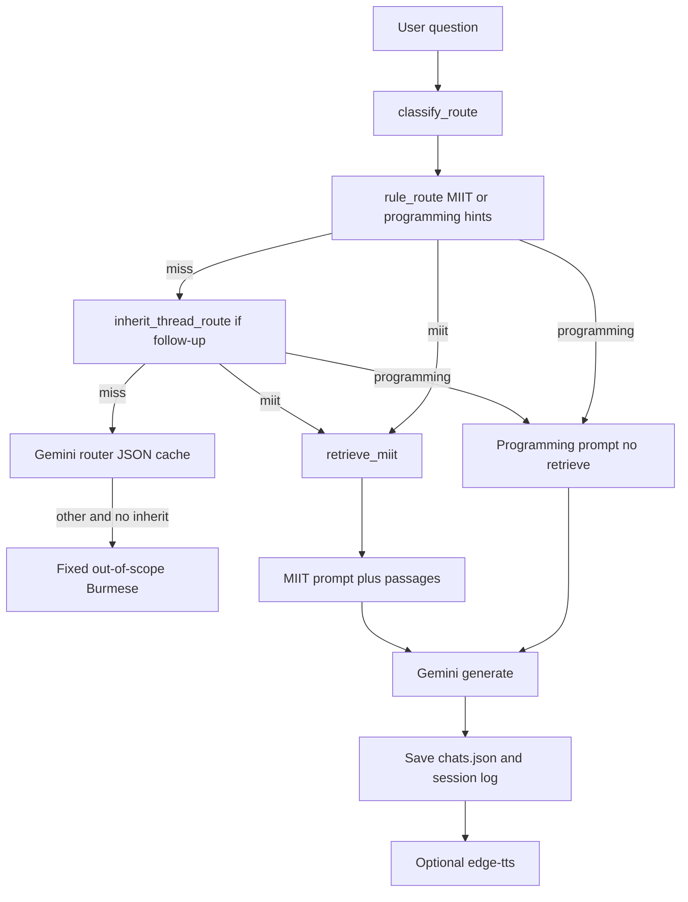

# Working flow

How this tutor answers a question, from setup through the React UI and AAA API, routing, MIIT notes, Gemini, Postgres chat sessions, and speech. Laptop install steps live in [LAPTOP_SETUP.md](LAPTOP_SETUP.md).

The app is a **Burmese CSE/ECE tutor**. Default backend **`aaa`** matches [Agentic Academic Assistance](https://github.com/SiThuTun22/Agentic_Academic_Assistance): LangGraph routing, pgvector RAG under `knowledge/`, LangChain Gemini pool. Set `TUTOR_BACKEND=hybrid` to use the legacy local `data/miit/index.json` path instead.

**In scope only:** MIIT institute knowledge (faculty, campus, courses) and **computer-engineering** subjects (CSE/ECE programming, circuits, OS, networks, etc.). Weather, sports, biology, general chit-chat, and other off-topic asks get the fixed Burmese refusal (`OUT_OF_SCOPE_ANSWER`) without calling the tutor model. On `aaa`, MIIT asks also require at least one retrieved knowledge chunk (`tutor/aaa_scope.py`). Faculty questions work in **Myanmar or English**; [`tutor/faculty_query.py`](../tutor/faculty_query.py) maps names like စင်သီယာမြင့် to Cynthia Myint for pgvector retrieval. Document upload exists on the API but is not in the React UI (v1).

There is no local fine-tuned model. Chat is Gemini (`gemini-3.1-flash-lite` by default).

## Surfaces

| Surface | Command | History / chats | Extra |
|---------|---------|-----------------|-------|
| **React UI** | `make web` + `make api` | Yes. Postgres sessions via [`app/`](../app/) | TTS Speak toggle, theme |
| **AAA HTTP API** | `make serve-api` | Yes (auth + session routes) | Same backend as React |
| **Stateless API** | [`tutor/api.py`](../tutor/api.py) | No | `POST /v1/chat` only |
| **CLI** | `make chat` | No | Optional pasted code |

The product UI uses LangGraph + DB (`send_message_exchange` in [`app/services/chat/messages.py`](../app/services/chat/messages.py)). CLI and stateless API call `create_engine().answer()` without thread history.

---

## 1. Setup

1. `make sync` (`uv sync --extra app --extra aaa`)
2. `cp .env.example .env` and set `GEMINI_API_KEYS` (or legacy `GEMINI_API_KEY`) from Google AI Studio. Where Google APIs are blocked, use a VPN.
3. **AAA (default):** `make db-up` → `make db-migrate` → `make db-ingest` (Postgres + pgvector on port **5435**, container `programming-tutor-postgres`; `knowledge/` points at `data/miit` JSONL via symlinks).
4. **Hybrid only:** `make miit-index` — writes `data/miit/index.json` (gitignored).
5. `make preflight` — then `make api` (http://127.0.0.1:8001) and `make web` (http://127.0.0.1:5173)

Optional keys in `.env`:

| Variable | Used for |
|----------|----------|
| `GEMINI_API_KEYS` | Comma-separated pool: chat, MIIT embed, router, TTS map helpers (AAA) |
| `GEMINI_API_KEY` / `GEMINI_API_KEY_FALLBACK` | Legacy keys used when `GEMINI_API_KEYS` is empty |
| `GEMINI_MAX_TOKENS` | Chat `max_output_tokens` (legacy: `TUTOR_CLOUD_MAX_TOKENS`; default 2048) |
| `GEMINI_EMBEDDING_MODEL` | MIIT index embed model (legacy: `GEMINI_EMBED_MODEL`) |
| `RAG_TOP_K` | Retrieval top-k (legacy: `MIIT_TOP_K`; default 5) |
| `GEMINI_TIMEOUT_SECONDS` | HTTP timeout for `google-genai` client (default 120) |
| `GEMINI_TTS_NAMES_API_KEY` | Optional single key for router + speech-name JSON only (default: same pool as chat) |

After you edit any `data/miit/*.jsonl` file, run `make miit-index` again.

---

## 2. Index build (`make miit-index`)

[`scripts/build_miit_index.py`](../scripts/build_miit_index.py):

1. Load every `*.jsonl` under `data/miit/` (`id`, `text`, `sources[]`).
2. Embed all `text` fields with `GEMINI_EMBEDDING_MODEL` (default `gemini-embedding-001`) via [`tutor/gemini_client.py`](../tutor/gemini_client.py).
3. Write `data/miit/index.json`: `{embed_model, built_at, chunks: [{id, text, sources, embedding}]}`.
4. Clear in-memory index caches.

Notes shipped today:

- `institute.jsonl` — campus, governance, programs
- `bachelor_admission.jsonl` — B.E. (Hons) CSE/ECE admission
- `cse_be_hons.jsonl` — CSE B.E. (Hons) years and electives
- `ece_be_hons.jsonl` — ECE B.E. (Hons) years and electives
- `cynthia_myint.jsonl` — faculty / papers
- `aye_aye_thant.jsonl`, `kyawt_kyawt_htay.jsonl`, `phyu_thwe.jsonl`, `tin_moh_moh_lwin.jsonl`, `zar_chi_su_su_hlaing.jsonl` — faculty / papers

If the index file is missing at ask time, retrieval falls back to token overlap and prints a stderr hint.

---

## 3. App boot

`make api` runs preflight, then [`scripts/serve_aaa_api.py`](../scripts/serve_aaa_api.py) (Litestar [`app/main.py`](../app/main.py)). `make web` starts the Vite dev server in `web/` (proxies `/api` to port 8001).

[`scripts/preflight_tutor.py`](../scripts/preflight_tutor.py) fails unless:

- `TUTOR_BACKEND` is `aaa` or `hybrid`
- Chat key exists (`GEMINI_API_KEYS` or `GEMINI_API_KEY`)
- **hybrid:** `data/miit/index.json` when `MIIT_RETRIEVAL=embed`
- **aaa:** `knowledge/` layout exists

It warns if only one key is in the pool (suggest comma-separated `GEMINI_API_KEYS`).

React boot:

1. Register / login → JWT in `localStorage`.
2. `GET /api/chat-sessions` for the sidebar; **New chat** creates a session row.
3. `POST /api/chat-sessions/{id}/messages` with `{ "content": "..." }` runs the tutor pipeline and persists user + assistant messages.
4. Light/Dark theme from `localStorage` on `document.documentElement`.

Legacy [`tutor/chats.py`](../tutor/chats.py) (`results/chats.json`) is for CLI experiments only; the React UI does not read it.

---

## 4. One React question

### UI → engine

1. Student types in the composer and clicks **Ask**.
2. React shows a loading state while `POST .../messages` is in flight.
3. [`send_message_exchange`](../app/services/chat/messages.py) loads prior messages from Postgres, calls [`generate_tutor_reply`](../app/ai/tutor.py) (LangGraph), stores both sides, may auto-title the session.
4. On quota / 503 errors, the API returns an error payload; the UI surfaces a short message.
5. **Speak** fetches `GET .../messages/{id}/speech` (MP3), caches the blob, and toggles play / pause / replay via a shared audio element.

Stateless `POST /v1/chat` still does `engine.answer(question, code)` **without** `history`. CLI is one shot, no thread.

---

## 5. Routing (`tutor/router.py`)

`classify_route(question, code, history)` returns `miit`, `programming`, `other`, or `None`.

Order:

1. **Rules** (`rule_route`):
   - MIIT if `looks_like_miit` on question or code (hints such as `miit`, `cse`, `ပါမောက္ခ`, `စင်သီယာ`, `win aye`, …).
   - Programming (CE subjects + code) if there is pasted code, or hints such as `python`, `loop`, `react`, `ohm`, `circuit`.
2. **Inherit** (`inherit_thread_route`): if the new ask looks like a follow-up, walk **all** prior turns (question + answer) and reuse the last `miit` or `programming` topic. Follow-up = a hint (`သူမ`, `အဲဒါ`, `အပို`, `ရှိသေး`, `အသေးစိတ်`, `more`, …) **or** length ≤ 48 characters.
3. **LLM router** (shared Gemini pool): JSON `{"route":"miit"|"programming"|"other"}`. Cached in memory and `.cache/router/`. Cache key is **this question + code only**, not history. Prior user question is included in the prompt so the model can keep the same route.
4. **`"other"` remap**: if rules/LLM say `other` but inherit finds a thread topic, keep that topic. Hybrid retries inherit once more if `classify_route` still returned `other`.

If the result is still `other`, the engine returns `OUT_OF_SCOPE_ANSWER` and does not call the chat model.

If classification is `None` (empty router key and no rules), hybrid falls through to `retrieve_miit` as a safety net.

---

## 6. Retrieval (`tutor/knowledge.py`)

Runs only when the route is `miit` (or the unclassified fallback). Programming skips this.

1. `retrieve_query` = last **two** history questions + the new question (so “အသေးစိတ်” still matches CSE / faculty notes).
2. If that blob does not `looks_like_miit`, return no chunks.
3. Default `MIIT_RETRIEVAL=embed`:
   - Embed the query (`gemini-embedding-001`, LRU-cached).
   - Cosine similarity vs `index.json`. Keep scores ≥ `MIIT_MIN_SIMILARITY` (0.55).
   - Top-k: 3 normally, **5** for papers (`စာတမ်း`, `အသေးစိတ်`, …), **12** for curriculum (`သင်ရိုး`, CSE/`hons` + detail, …), **4** for institute overview (`MIIT ဆိုတာ ဘာလဲ`, `what is MIIT`, …).
   - **Intent routing** (embed and token paths): overview questions rank only `institute-*` chunks (not `admission-*`); admission questions prefer `admission-*`. Specialists apply the same filter for overview turns.
4. If the index is missing, or embed returns 429, fall back to token overlap (Latin + Myanmar tokens, stopwords stripped).

`HybridEngine` still uses the **MIIT prompt** when the route is `miit`, even if retrieval returned zero passages. The model is told to say it does not know rather than invent faculty or elective codes.

---

## 7. Prompts (`tutor/prompts.py`)

Two builders. Both ask for spoken Burmese, English names for people/orgs, `သူမ`/`သူ` (not `၎င်း` for people), and end with `ဆရာ့အဖြေ:` which is stripped from the reply.

**Programming** (`build_general_tutor_messages`): beginner tutor, short paragraphs, keep terms like `function` / `library` in English. First turn picks a random delivery style (analogy / example / common mistake). Later turns use `CONTINUE_STYLE`.

**MIIT** (`build_miit_messages`): notes-only. Inject retrieved `text` plus each `source:` URL. Extra rules:

- Who-questions: name, title, workplace in the first sentence. Do not open with campus praise.
- Institute overview: lead with what MIIT is (name, Mandalay, founding year, mission/NCoE); do not open with bachelor entrance rules unless the student asked admission.
- Admission: exam subjects, score weights, quotas from notes only.
- Papers: list only notes that exist; URLs at the end.
- Curriculum: list every year/semester in the notes; do not invent elective codes.

The last **three** `{question, answer}` turns are appended. `FOLLOW_THREAD_LINE` tells the model this is a follow-up: answer the new ask, do not restart the bio or paste URLs again unless asked.

---

## 8. Generation

[`tutor/gemini_client.py`](../tutor/gemini_client.py) (default):

1. Flatten messages to a single `role:\ncontent` prompt.
2. Sampling: programming `TUTOR_TEMPERATURE=0.85` / `TUTOR_TOP_P=0.95`; MIIT `0.7` / `0.9`. Max tokens `GEMINI_MAX_TOKENS` (legacy `TUTOR_CLOUD_MAX_TOKENS`; default 2048).
3. Round-robin `GEMINI_API_KEYS` with per-key cooldown on 429 (AAA-style). Retry network and 5xx with backoff; rotate to the next pool key on quota errors before failing with “all keys rate-limited”.

---

## 9. Chats, theme, speech

### Sidebar (Postgres)

- **New chat** → `POST /api/chat-sessions`.
- **Open** → load messages for that session id.
- **Delete** → `DELETE /api/chat-sessions/{id}` (permanent).
- Session **title** from first question (server-side). **Female/Male** voice → `PATCH` session `tutor_avatar`; new assistant messages inherit it.

### Theme

React header toggle sets `dark` class on `document.documentElement` and `localStorage`.

### Smoke checklist (`TUTOR_BACKEND=aaa`)

1. `make db-up && make db-migrate && make db-ingest`
2. Register at http://localhost:5173
3. Ask “What's the weather?” → refusal
4. Ask “Python for loop ရှင်းပြပါ” → CE answer
5. Ask “MIIT ဆိုတာ ဘာလဲ” → institute overview
6. **Speak** on an assistant message → MP3 from speech endpoint

### Speak / Voice ([`app/ai/tts.py`](../app/ai/tts.py))

1. `prepare_for_speech` (strip URLs, name maps, optional Gemini name JSON).
2. `edge-tts` (`my-MM-NilarNeural` / `my-MM-ThihaNeural`). Needs outbound internet.
3. UI caches audio per message id; click toggles play / pause; after `ended`, replay from start.

---

## 10. Not in this flow

- No local weights, LoRA, or RAG beyond `data/miit`.
- API and CLI do not persist chats or pass history, so they will not inherit a CSE/faculty thread.
- Router disk cache ignores history; inherit/walk-back is what keeps a short follow-up on MIIT in threaded UIs (React sessions).
- Editing JSONL without `make miit-index` leaves the old embeddings in `index.json`.
- `make smoke-hybrid` is a 15-prompt live Gemini check, not part of a student ask.
